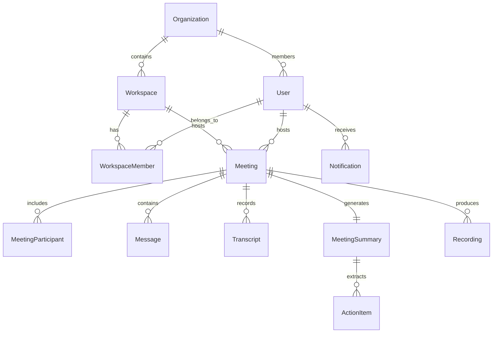

# IntellMeet — Database Schema Specification

This document provides complete documentation of the 12 core Mongoose collections powering IntellMeet, including field types, validation rules, indexes, and entity relationships.

---

## 1. Entity-Relationship Diagram (ERD)

---

## 2. Collection Schemas

### 2.1 `users` Collection
Stores user identity, organizational membership, roles, and media preferences.

| Field | Type | Validation / Constraints | Description |
| :--- | :--- | :--- | :--- |
| `_id` | ObjectId | Auto-generated PK | Unique user identifier |
| `name` | String | Required, trim, 2-100 chars | Display name |
| `email` | String | Required, unique, match email regex | Primary contact and login email |
| `passwordHash`| String | Optional (for OAuth), `select: false` | Bcrypt hashed password |
| `avatarUrl` | String | Default: `""` | User profile avatar |
| `role` | String | Enum: `['super_admin', 'admin', 'member', 'guest']` | System role |
| `organizationId`| ObjectId | Ref: `Organization`, Index | Parent organization |
| `isActive` | Boolean | Default: `true` | Account status flag |
| `preferences` | Object | Subdocument | Media & appearance preferences |
| ↳ `theme` | String | Enum: `['light', 'dark', 'system']` | Preferred color theme |
| ↳ `defaultMicEnabled` | Boolean | Default: `true` | Microphone default |
| ↳ `defaultCamEnabled` | Boolean | Default: `true` | Camera default |
| ↳ `transcriptionLanguage` | String | Default: `'en-US'` | SpeechRecognition language code |
| `lastLoginAt` | Date | Optional | Timestamp of last session |
| `createdAt` | Date | Timestamps: true | Creation timestamp |
| `updatedAt` | Date | Timestamps: true | Last update timestamp |

**Indexes:**
- `{ email: 1 }` (unique)
- `{ organizationId: 1, role: 1 }`

---

### 2.2 `organizations` Collection
Represents top-level corporate tenants with billing tiers and security policies.

| Field | Type | Validation / Constraints | Description |
| :--- | :--- | :--- | :--- |
| `_id` | ObjectId | Auto-generated PK | Unique organization identifier |
| `name` | String | Required, trim, max 100 chars | Organization name |
| `slug` | String | Required, unique, lowercase | URL-safe slug |
| `logoUrl` | String | Default: `""` | Organization logo |
| `ownerId` | ObjectId | Ref: `User`, Required, Index | Organization owner |
| `tier` | String | Enum: `['starter', 'pro', 'enterprise']` | Subscription tier |
| `maxMeetingDurationMinutes`| Number | Default: `240` | Duration limits |
| `maxParticipantsPerMeeting`| Number | Default: `100` | Room capacity |
| `billing` | Object | Status & Stripe IDs | Billing state |
| `settings` | Object | Retention & guest policies | Enterprise governance |

---

### 2.3 `workspaces` Collection
Departmental or team groupings within an organization.

| Field | Type | Validation / Constraints | Description |
| :--- | :--- | :--- | :--- |
| `_id` | ObjectId | Auto-generated PK | Unique workspace identifier |
| `organizationId`| ObjectId | Ref: `Organization`, Required | Parent organization |
| `name` | String | Required, trim, max 80 chars | Team/workspace name |
| `slug` | String | Required, trim, lowercase | Workspace URL slug |
| `description` | String | Max 300 chars | Workspace purpose |
| `isPrivate` | Boolean | Default: `false` | Privacy flag |
| `defaultRole` | String | Enum: `['owner', 'admin', 'member', 'guest']` | Default member permission |

**Indexes:**
- `{ organizationId: 1, slug: 1 }` (compound unique)

---

### 2.4 `workspacemembers` Collection
Join table managing member permissions within a workspace.

| Field | Type | Validation / Constraints | Description |
| :--- | :--- | :--- | :--- |
| `_id` | ObjectId | Auto-generated PK | Unique membership ID |
| `workspaceId` | ObjectId | Ref: `Workspace`, Required | Target workspace |
| `userId` | ObjectId | Ref: `User`, Required | Target user |
| `role` | String | Enum: `['owner', 'admin', 'member', 'guest']` | Membership role |
| `permissions` | Array<String> | Default: `['create_meeting', ...]` | Granular capabilities |
| `joinedAt` | Date | Default: `Date.now` | Enrollment timestamp |

**Indexes:**
- `{ workspaceId: 1, userId: 1 }` (compound unique)

---

### 2.5 `meetings` Collection
Core conference entity recording session status, room parameters, settings, and summaries.

| Field | Type | Validation / Constraints | Description |
| :--- | :--- | :--- | :--- |
| `_id` | ObjectId | Auto-generated PK | Unique meeting ID |
| `title` | String | Trim, max 150 chars | Session title |
| `roomId` | String | Required, unique, index | Unique room code for URL access |
| `passCode` | String | Optional | Room password / PIN |
| `hostId` | ObjectId | Ref: `User`, Index | Meeting creator |
| `hostName` | String | Required, trim | Display name of the host |
| `workspaceId`| ObjectId | Ref: `Workspace`, Index | Associated workspace |
| `status` | String | Enum: `['scheduled', 'live', 'completed', 'cancelled']` | Meeting state |
| `type` | String | Enum: `['instant', 'scheduled', 'recurring']` | Scheduling type |
| `participantsCount`| Number | Default: `1` | Total attendees |
| `participantsList` | Array<String> | Default: `[]` | Attendee names list |
| `settings` | Object | Entry mute, camera, screen share rules | Room rules |
| `summary` | String | Default: `""` | Generated meeting summary |
| `keyDecisions` | Array<String>| Default: `[]` | Extracted consensus decisions |
| `actionItems` | Array<Object>| Id, text, assignee, completed | To-do items checklist |

**Indexes:**
- `{ roomId: 1 }` (unique)
- `{ workspaceId: 1, status: 1, createdAt: -1 }`
- `{ hostId: 1, createdAt: -1 }`

---

### 2.6 `meetingparticipants` Collection
Logs individual participant attendance, duration, hardware states, and peer IDs.

| Field | Type | Validation / Constraints | Description |
| :--- | :--- | :--- | :--- |
| `_id` | ObjectId | Auto-generated PK | Participant session ID |
| `meetingId` | ObjectId | Ref: `Meeting`, Required, Index | Associated meeting |
| `userId` | ObjectId | Ref: `User`, Optional (for guests) | User ID if authenticated |
| `guestName` | String | Required, trim | Participant display name |
| `socketId` | String | Required, Index | Socket.io connection ID |
| `peerId` | String | Optional | WebRTC peer identifier |
| `role` | String | Enum: `['host', 'co_host', 'participant', 'viewer']` | Room permission role |
| `joinedAt` | Date | Default: `Date.now` | Connection start |
| `leftAt` | Date | Optional | Connection end |
| `durationSeconds`| Number | Default: `0` | Attendance length |
| `audioEnabled`| Boolean | Default: `true` | Microphone active state |
| `videoEnabled`| Boolean | Default: `true` | Camera active state |
| `screenSharing`| Boolean | Default: `false` | Screen presentation state |

---

### 2.7 `messages` Collection
Persistent real-time text chat messages sent during meeting sessions.

| Field | Type | Validation / Constraints | Description |
| :--- | :--- | :--- | :--- |
| `_id` | ObjectId | Auto-generated PK | Unique message ID |
| `meetingId` | ObjectId | Ref: `Meeting`, Required, Index | Associated meeting |
| `senderId` | ObjectId | Ref: `User`, Optional | Sender user ID |
| `senderName` | String | Required, trim | Sender display name |
| `content` | String | Required, max 4000 chars | Text payload |
| `type` | String | Enum: `['text', 'file', 'system', 'code']` | Message classification |
| `attachments`| Array<Object>| File metadata | Attached documents |
| `reactions` | Array<Object>| Emoji & User ID | Message emoji reactions |
| `isSystem` | Boolean | Default: `false` | System broadcast indicator |

---

### 2.8 `transcripts` Collection
Timestamped voice speech recognition transcripts.

| Field | Type | Validation / Constraints | Description |
| :--- | :--- | :--- | :--- |
| `_id` | ObjectId | Auto-generated PK | Unique transcript chunk ID |
| `meetingId` | ObjectId | Ref: `Meeting`, Required, Index | Associated meeting |
| `speakerId` | ObjectId | Ref: `User`, Optional | Speaker user ID |
| `speakerName`| String | Required, trim | Spoken voice participant |
| `text` | String | Required, trim | Spoken dialogue text |
| `startTime` | Number | Required, milliseconds | Audio start offset |
| `endTime` | Number | Optional | Audio end offset |
| `confidence`| Number | Range: `0.0 - 1.0` | STT confidence rating |
| `language` | String | Default: `'en-US'` | Spoken language |
| `isFinal` | Boolean | Default: `true` | Finalized recognition flag |

**Indexes:**
- `{ meetingId: 1, startTime: 1 }`

---

### 2.9 `meetingsummaries` Collection
Autonomous AI-generated executive summaries and meeting minutes.

| Field | Type | Validation / Constraints | Description |
| :--- | :--- | :--- | :--- |
| `_id` | ObjectId | Auto-generated PK | Summary identifier |
| `meetingId` | ObjectId | Ref: `Meeting`, Required, Unique, Index | 1-to-1 relationship with Meeting |
| `executiveSummary`| String | Required, trim | High-level takeaway paragraph |
| `keyDecisions` | Array<String>| Default: `[]` | Extracted consensus points |
| `topicsDiscussed`| Array<String>| Default: `[]` | High-level discussion topics |
| `nextSteps` | Array<String>| Default: `[]` | Agreed follow-ups |
| `sentiment` | String | Enum: `['positive', 'neutral', 'constructive', 'mixed']` | Conversation sentiment |
| `generatedBy` | String | Enum: `['openai', 'rule_based_nlp', 'manual']` | Processing engine |
| `tokensUsed` | Number | Default: `0` | LLM token usage metric |

---

### 2.10 `actionitems` Collection
Discrete tasks extracted from meeting transcripts and assigned to specific team members.

| Field | Type | Validation / Constraints | Description |
| :--- | :--- | :--- | :--- |
| `_id` | ObjectId | Auto-generated PK | Unique task identifier |
| `meetingId` | ObjectId | Ref: `Meeting`, Required, Index | Originating meeting |
| `summaryId` | ObjectId | Ref: `MeetingSummary`, Index | Originating summary |
| `text` | String | Required, trim | Task description |
| `assigneeName` | String | Required, default: `'Unassigned'` | Target owner |
| `assigneeId` | ObjectId | Ref: `User`, Optional, Index | Assigned user ID |
| `dueDate` | Date | Optional | Task deadline |
| `priority` | String | Enum: `['low', 'medium', 'high']` | Urgency tier |
| `status` | String | Enum: `['pending', 'in_progress', 'completed', 'cancelled']` | Task execution state |
| `completedAt` | Date | Optional | Completion timestamp |

**Indexes:**
- `{ meetingId: 1, status: 1 }`
- `{ assigneeId: 1, status: 1 }`

---

### 2.11 `recordings` Collection
Archived audio/video session recordings and cloud media metadata.

| Field | Type | Validation / Constraints | Description |
| :--- | :--- | :--- | :--- |
| `_id` | ObjectId | Auto-generated PK | Recording identifier |
| `meetingId` | ObjectId | Ref: `Meeting`, Required, Index | Associated meeting |
| `storageUrl` | String | Required, trim | S3/GCS object storage URL |
| `durationSeconds`| Number | Default: `0` | Video playback duration |
| `fileSizeBytes`| Number | Default: `0` | File size |
| `format` | String | Enum: `['mp4', 'webm']` | Media container |
| `status` | String | Enum: `['processing', 'ready', 'failed']` | Transcoding state |
| `transcriptionStatus`| String | Enum: `['pending', 'processing', 'completed', 'failed']` | Post-recording audio STT |

---

### 2.12 `notifications` Collection
In-app and email alert dispatches for meeting invitations and AI summary completions.

| Field | Type | Validation / Constraints | Description |
| :--- | :--- | :--- | :--- |
| `_id` | ObjectId | Auto-generated PK | Notification identifier |
| `recipientId` | ObjectId | Ref: `User`, Required, Index | Target user |
| `senderId` | ObjectId | Ref: `User`, Optional | Originating user |
| `type` | String | Enum: `['meeting_invite', 'meeting_summary_ready', 'action_item_assigned', ...]` | Category |
| `title` | String | Required, max 120 chars | Notification subject |
| `message` | String | Required, max 500 chars | Body content |
| `link` | String | Optional | Target app route |
| `read` | Boolean | Default: `false`, Index | Read receipt |
| `readAt` | Date | Optional | Read timestamp |

**Indexes:**
- `{ recipientId: 1, read: 1, createdAt: -1 }`
