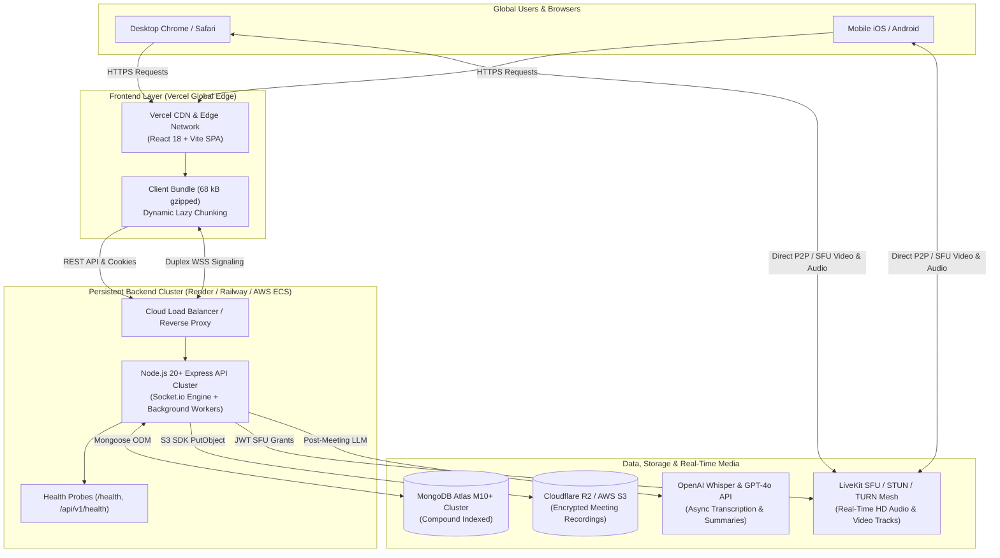

# IntellMeet — Enterprise Production Deployment Guide

**Target Environment:** Production SaaS Deployment  
**Audience:** Senior DevOps Engineers, Cloud Architects, System Administrators  
**Date:** October 2026  
**Version:** 1.0.0  

---

## 1. Production Architecture Overview

IntellMeet is engineered as a high-availability, decoupled enterprise microservices and real-time collaboration platform:



---

## 2. Frontend Deployment on Vercel

### 2.1 Option A: Deploying from Monorepo Root (Recommended)
1. Push your repository to GitHub / GitLab.
2. In the [Vercel Dashboard](https://vercel.com/new), select **Import Git Repository**.
3. Configure Project Settings:
   - **Framework Preset:** Vite
   - **Root Directory:** `./` (leave as root)
   - **Build Command:** `npm run build:client`
   - **Output Directory:** `client/dist`
   - **Install Command:** `npm ci`
4. The included root `vercel.json` will automatically configure:
   - Full SPA routing (`/(.*)` rewrite to `/index.html`).
   - Immutable 1-year caching for `/assets/` bundles.
   - Enterprise security headers (`X-Frame-Options: DENY`, `X-Content-Type-Options: nosniff`, `Permissions-Policy` for camera/microphone).

### 2.2 Option B: Deploying with Root Directory set to `client`
1. If configuring the Vercel project with **Root Directory** = `client`:
   - **Framework Preset:** Vite
   - **Build Command:** `npm run build`
   - **Output Directory:** `dist`
2. The included `client/vercel.json` provides identical rewrite rules and caching directives.

### 2.3 Required Frontend Environment Variables
In **Project Settings > Environment Variables**, add:

| Variable Name | Example Value | Description |
| :--- | :--- | :--- |
| `VITE_API_URL` | `https://api.intellmeet.yourdomain.com` | Public URL of the persistent backend Express API |
| `VITE_SOCKET_URL` | `https://api.intellmeet.yourdomain.com` | Public URL of the Socket.io signaling server |

> [!CAUTION]
> Never put MongoDB connection strings, JWT secrets, or OpenAI private keys in Vercel environment variables. Vite variables prefixed with `VITE_` are compiled into public JavaScript code.

---

## 3. Backend Deployment on Persistent Node.js Hosts

Because IntellMeet utilizes persistent bi-directional WebSockets (`Socket.io`) and in-memory background job queues, the backend requires a **persistent Node.js host** (e.g. Render, Railway, Fly.io, AWS ECS, or a self-hosted Docker cluster). Serverless functions (such as AWS Lambda or Vercel Serverless) are not suitable for persistent WebSocket connections.

### 3.1 Option A: Render Cloud Deployment (`render.yaml`)
1. Create a new **Blueprint** in Render pointing to this repository.
2. Render reads the included `render.yaml` configuration:
   - Standard Node.js web service.
   - Automatic health checks at `/health`.
   - 10 GB persistent disk mounted at `/app/uploads` for recordings.
3. Configure the environment variables specified in Section 4.

### 3.2 Option B: Docker Container Deployment
The included production multi-stage `Dockerfile` produces a hardened Alpine container running on Node 20 with `dumb-init` signal handling and built-in health probes:

```bash
# 1. Build the production image
docker build -t intellmeet-backend:latest .

# 2. Run the container
docker run -d \
  --name intellmeet-server \
  -p 5000:5000 \
  --env-file .env \
  -v intellmeet_recordings:/app/uploads/recordings \
  intellmeet-backend:latest
```

### 3.3 Option C: Docker Compose Full Stack (Self-Hosted)
Deploy both the backend and a local persistent MongoDB replica with a single command:

```bash
docker compose up -d --build
```
Inspect container health:
```bash
docker compose ps
docker compose logs -f backend
```

### 3.4 Option D: Bare Metal / Virtual Machine with PM2 Cluster
For deployment on AWS EC2, DigitalOcean Droplet, or dedicated Linux servers:
```bash
# 1. Install production dependencies and compile TypeScript
npm ci
npm run build

# 2. Launch PM2 cluster across all CPU cores
pm2 start ecosystem.config.js --env production

# 3. Save PM2 startup script
pm2 save
pm2 startup
```

---

## 4. Environment Variables Reference

Configure the following variables on your persistent backend host:

| Variable | Required | Default / Example | Purpose |
| :--- | :---: | :--- | :--- |
| `NODE_ENV` | **Yes** | `production` | Enables production optimizations and disables debug traces |
| `PORT` | **Yes** | `5000` (or host assigned) | Port on which Express and Socket.io listen |
| `MONGODB_URI` | **Yes** | `mongodb+srv://...` | MongoDB Atlas cluster connection string with credentials |
| `JWT_SECRET` | **Yes** | Minimum 32-character random string | Secret key for signing 15-minute access JWTs |
| `JWT_REFRESH_SECRET`| **Yes** | Minimum 32-character random string | Secret key for signing 7-day refresh JWTs |
| `CLIENT_URL` | **Yes** | `https://intellmeet.vercel.app` | Allowed CORS origins (comma-separated for multiple domains) |
| `OPENAI_API_KEY` | Optional | `sk-proj-...` | Enables OpenAI Whisper audio transcription and GPT-4o summaries |
| `AI_PROVIDER` | Optional | `openai` or `builtin` | Provider mode (`builtin` works offline with contextual NLP) |
| `STORAGE_ENDPOINT` | Optional | `https://<id>.r2.cloudflarestorage.com` | Cloudflare R2 or S3 API endpoint for recordings |
| `STORAGE_BUCKET` | Optional | `intellmeet-recordings` | S3 / R2 storage bucket name |
| `STORAGE_ACCESS_KEY`| Optional | `your_r2_access_key` | S3 / R2 access key ID |
| `STORAGE_SECRET_KEY`| Optional | `your_r2_secret_key` | S3 / R2 secret access key |
| `VIDEO_PROVIDER_URL`| Optional | `wss://livekit.yourdomain.com` | SFU WebSocket gateway for video/audio tracks |
| `VIDEO_PROVIDER_API_KEY` | Optional | `your_livekit_key` | SFU API authentication key |
| `VIDEO_PROVIDER_API_SECRET` | Optional | `your_livekit_secret` | SFU API secret for signing JWT room tokens |
| `STUN_SERVERS` | Optional | `stun:stun.l.google.com:19302` | Comma-separated list of STUN servers for NAT traversal |
| `TURN_SERVER_URL` | Optional | `turn:turn.yourdomain.com:3478` | TURN server for symmetric NAT and firewall traversal |
| `TURN_USERNAME` | Optional | `intellmeet_user` | TURN server authentication username |
| `TURN_CREDENTIAL` | Optional | `turn_password_or_token` | TURN server authentication credential |

---

## 5. Database Configuration (MongoDB Atlas)

1. **Create an Atlas Cluster:**
   - Log into [MongoDB Atlas](https://cloud.mongodb.com).
   - Create an `M10` or higher dedicated cluster for production (or `M0` for staging).
2. **Database Access:**
   - Create a database user with `readWriteAnyDatabase` or scoped read/write access to the `intellimeet` database.
3. **Network Access (IP Whitelist):**
   - In **Network Access**, add the static IP addresses of your backend hosts (or `0.0.0.0/0` if hosting on dynamically assigned PaaS providers such as Render or Railway).
4. **Copy Connection String:**
   - Click **Connect** > **Drivers** > **Node.js**.
   - Copy the SRV URI: `mongodb+srv://<username>:<password>@cluster0.abcde.mongodb.net/intellimeet?retryWrites=true&w=majority`.
   - Set as `MONGODB_URI` on your backend.

---

## 6. Cloudflare R2 / S3 Storage Configuration

1. In the [Cloudflare Dashboard](https://dash.cloudflare.com), navigate to **R2**.
2. Create a bucket named `intellmeet-recordings`.
3. Under **Settings > CORS Policy**, add:
   ```json
   [
     {
       "AllowedOrigins": ["https://intellmeet.vercel.app", "http://localhost:5173"],
       "AllowedMethods": ["GET", "PUT", "POST", "HEAD"],
       "AllowedHeaders": ["*"],
       "MaxAgeSeconds": 3600
     }
   ]
   ```
4. Create an **R2 API Token** with `Object Read & Write` permissions.
5. Provide `STORAGE_ENDPOINT`, `STORAGE_BUCKET`, `STORAGE_ACCESS_KEY`, and `STORAGE_SECRET_KEY` to the backend.

---

## 7. WebRTC SFU & STUN/TURN Infrastructure

1. **STUN Configuration:**
   - IntellMeet defaults to Google's public STUN infrastructure (`stun.l.google.com:19302`), which handles $>85\%$ of direct peer connections across standard NAT routers.
2. **TURN Configuration (Enterprise Firewalls):**
   - For users behind strict corporate firewalls, symmetric NATs, or VPNs, configure a Coturn server or Twilio Network Traversal service.
   - Set `TURN_SERVER_URL`, `TURN_USERNAME`, and `TURN_CREDENTIAL`.
3. **LiveKit SFU (Multi-Party Conferences):**
   - Sign up for [LiveKit Cloud](https://livekit.io) or deploy self-hosted LiveKit on Kubernetes.
   - Set `VIDEO_PROVIDER_URL`, `VIDEO_PROVIDER_API_KEY`, and `VIDEO_PROVIDER_API_SECRET`.

---

## 8. Post-Deployment Verification & Smoke Testing

Run the automated production deployment suite against your live endpoints:

```bash
# Run local verification
npx tsx tests/phase9_deployment_verification.test.ts
```

### Manual Smoke Test Checklist
- [ ] **Health Endpoint:** Navigate to `https://api.yourdomain.com/health`. Verify `status: "healthy"` and database status.
- [ ] **Frontend Loading:** Open `https://intellmeet.vercel.app`. Verify hero page loads in $<1\text{ second}$.
- [ ] **User Registration:** Create a new enterprise account. Confirm JWT tokens are set and redirected to dashboard.
- [ ] **Instant Meeting:** Click "New Meeting" and join the room. Check camera/microphone activation and active speaker indicator.
- [ ] **Chat & Signaling:** Open room in a second private browser window. Verify text messages appear instantly in both windows.
- [ ] **AI Summaries:** Click "End Meeting" $\to$ verify AI summary generation and action items display on dashboard.
